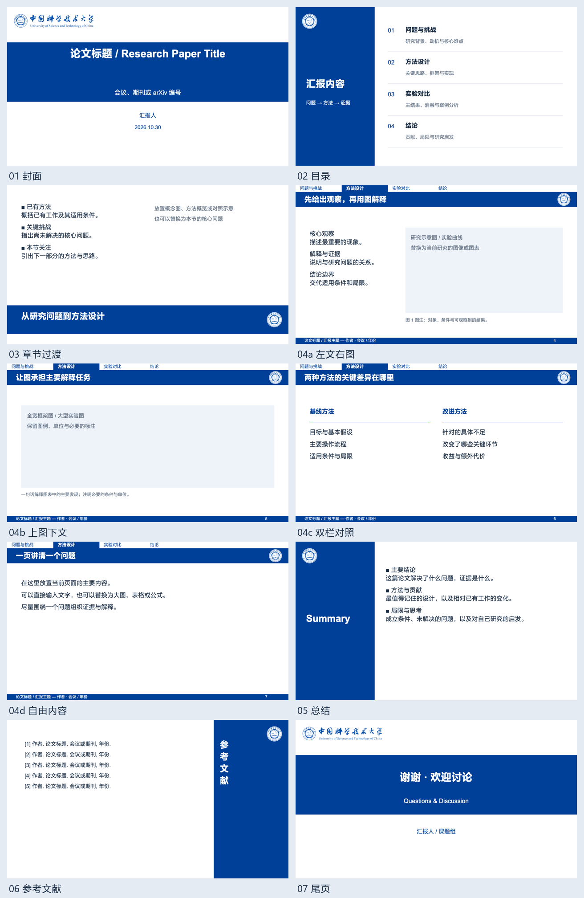
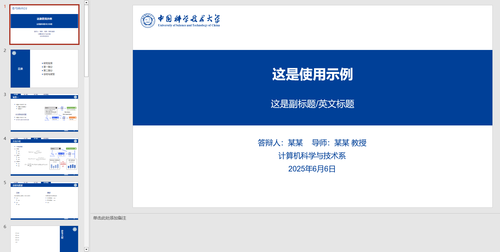

# USTC PPT Theme · 中国科学技术大学学术汇报模板

适用于论文精读、组会分享、研究进展和答辩的 PowerPoint 模板。提供可手工编辑的 PPTX，以及可供 [ppt-master](https://github.com/hugohe3/ppt-master) 使用的模板工作区。

## 下载与预览

| 版本 | 用途 | 文件 |
| --- | --- | --- |
| 简约学术组会 `academic_group_meeting` | 推荐；10 种版式，支持手工编辑和 AI 制作 | [版式示例 PPTX](academic_group_meeting/exports/简约学术组会_版式示例.pptx) · [模板工作区](academic_group_meeting/) |
| 通用占位符预览 | 查看模板占位框及原生版式结构 | [占位符预览 PPTX](academic_group_meeting/exports/academic_group_meeting_template_preview.pptx) |
| 原版 USTC 主题 | 沿用仓库早期版本制作报告或答辩 | [原版 PPTX](ustc-ppt-theme.pptx) |

点击文件后使用 GitHub 的 **Download raw file** 下载；也可以通过 **Code → Download ZIP** 下载整个仓库。



新模板使用 16:9 画布（1280 × 720）、科大蓝 `#004098`、四段章节导航、论文来源页尾，以及可编辑的母版和占位框。

| 版式 | 建议用途 |
| --- | --- |
| 封面 | 论文题目、来源、汇报人与日期 |
| 目录 | 汇报结构与主要问题 |
| 章节过渡 | 引出下一节问题或方法 |
| 左文右图 | 解释一张方法图或实验图 |
| 上图下文 | 宽幅框架图、大型实验结果 |
| 双栏对照 | 方法比较、条件对比、优缺点分析 |
| 自由内容 | 公式、表格或特殊内容 |
| 总结 | 贡献、局限与研究启发 |
| 参考文献 | 论文与素材来源 |
| 尾页 | 致谢与讨论 |

## 使用 PowerPoint 手工编辑

1. 下载并另存一份[版式示例 PPTX](academic_group_meeting/exports/简约学术组会_版式示例.pptx)。
2. 根据内容复制相应页面，替换标题、正文、图表、姓名和日期。模板中的参考文献是格式示例，需替换成真实条目。
3. 图表区域使用通用内容占位框；插入图片或图表后删除提示文字，保留图表原始比例、坐标轴和图例。
4. 四段导航按实际章节改名；切换章节时移动高亮色块，并调整对应标签的颜色与字重。
5. 背景色带、校徽等固定元素可在 **视图 → 幻灯片母版** 中修改。

默认英文字体为 Arial，中文为 Microsoft YaHei；SVG 的 Mac 预览后备字体为 PingFang SC。字体文件未随模板分发，缺少字体可能导致换行变化。模板字号、间距与布局规则见 [design_spec.md](academic_group_meeting/templates/design_spec.md)。

## 使用 ppt-master 应用模板

### 1. 安装 ppt-master

ppt-master 是在 AI 编程助手中运行的演示文稿工作流。先按其[安装说明](https://github.com/hugohe3/ppt-master#3-set-up)或[入门文档](https://github.com/hugohe3/ppt-master/blob/master/docs/getting-started.md)完成配置。

例如，在支持 Skills 的助手中，可以使用上游提供的安装命令：

```bash
npx skills add hugohe3/ppt-master
```

按安装器提示选择当前使用的助手。该命令下载技能文件；还需在实际安装的 `ppt-master` 目录中安装 Python 依赖：

```bash
python3 -m pip install -r requirements.txt
```

已有 ppt-master 时无需重复安装。本模板按 **ppt-master 6.8.0 的 Deck 工作区格式**整理，并使用该版本的模板检查工具验证；其他版本以其当前工作区契约为准。

### 2. 下载本仓库，取得模板根目录

```bash
git clone https://github.com/liano3/ustc-ppt-theme.git
cd ustc-ppt-theme
```

在 macOS / Linux 中查看模板绝对路径：

```bash
python3 -c "from pathlib import Path; print(Path('academic_group_meeting').resolve())"
```

在 Windows PowerShell 中：

```powershell
(Resolve-Path .\academic_group_meeting).Path
```

**把完整的 `academic_group_meeting` 目录交给 AI。** 其中同时包含 `templates/` 和 `images/`。只传内部 `templates/` 会漏掉校徽等素材；只传示例 PPTX 则会进入编辑现有文件的流程。

本仓库可以保存在任意 AI 助手能访问的本地目录，无需复制进 ppt-master 的安装目录，也无需修改它的模板索引。提供完整绝对路径即可按外部模板工作区使用。

### 3. 把论文、模板路径和要求一起发给 AI

在已加载 ppt-master 的助手中，替换下面的路径后直接发送：

```text
请使用 ppt-master，把这篇论文制作成中文组会分享 PPT。

论文：/你的绝对路径/paper.pdf
模板工作区：/你的绝对路径/ustc-ppt-theme/academic_group_meeting
输出目录：/你的绝对路径/paper-presentation

请使用指定的模板工作区，先读取 templates/design_spec.md。
保留科大蓝、校徽、章节导航、页尾来源及模板的字号层级。
根据内容选择左文右图、上图下文、双栏对照或自由内容版式。

报告约 30–40 分钟，面向本领域研究生。
讲清研究问题、背景与动机、方法设计、实验设置、主要结果、
消融与对照、局限，以及值得讨论的问题。
图表使用论文原图截图，保留坐标轴、图例和必要的实验条件；
在页尾注明图号和来源，不编造数据。

交付可编辑 PPTX，并为每页添加中文演讲备注。
请检查文字溢出、图表清晰度和章节导航状态。
后续版式和制作细节由你决定。
```

修改已有汇报时，向 AI 同时提供 **现有 PPTX、源材料和具体修改要求**；保留生成项目便于后续继续编辑。制作新汇报时，继续使用上面的模板工作区根目录。

### 4. 可选：通过命令行检查或应用工作区

以下命令调用的是 **ppt-master 安装目录内的脚本**，本仓库不包含生成引擎。将 `PPT_MASTER_DIR` 改为包含 `SKILL.md` 和 `scripts/` 的实际目录：

```bash
PPT_MASTER_DIR="/你的绝对路径/ppt-master"
TEMPLATE_ROOT="$(pwd)/academic_group_meeting"

# 检查模板包；在本仓库根目录执行。
python3 "$PPT_MASTER_DIR/scripts/svg_quality_checker.py" \
  "$TEMPLATE_ROOT/templates" --template-mode --canonical-authoring

# 将模板应用到一个由 ppt-master 创建的演示文稿项目。
# 先使用 --dry-run 查看复制计划，确认路径后再去掉该参数执行。
python3 "$PPT_MASTER_DIR/scripts/apply_template.py" \
  "/你的绝对路径/演示文稿项目" --root "$TEMPLATE_ROOT" --dry-run
```

应用工作区会安装设计规范、SVG 原型和素材；**不会自动把论文转换成成品 PPT**。内容策划、逐页制作、讲稿和导出仍由 ppt-master 工作流完成。通常直接使用上面的自然语言提示即可。

## 仓库结构

```text
ustc-ppt-theme/
├── README.md
├── LICENSE
├── THIRD_PARTY_NOTICES.md
├── ustc-ppt-theme.pptx              # 保留的原版
├── assets/                         # 原版预览
└── academic_group_meeting/          # 交给 ppt-master 的模板根目录
    ├── README.md
    ├── templates/
    │   ├── design_spec.md          # 配色、字体、版式与占位符规则
    │   └── *.svg                   # 10 个完整页面原型
    ├── images/                    # 校徽与完整校名标识
    └── exports/                   # PPTX 示例与版式总览
```

## 来源与许可

原版修改自 [atomiechen/THU-PPT-Theme](https://github.com/atomiechen/THU-PPT-Theme) 的 **v1 顶边 16:9** 模板。新增组会模板在本仓库 USTC 视觉基础上，整理了论文汇报版式、章节导航、SVG 原型和 ppt-master 工作区。

模板及本仓库的改编贡献沿用上游的 [CC BY-NC-SA 4.0](LICENSE)：署名、非商业性使用、相同方式共享。分享或再修改时，请保留来源并注明修改。本仓库是提供源文件的公开分享项目，该许可包含非商业限制。

校徽与校名标识来自 [USTC Logo 资源页](https://jbyang1987.github.io/ustclogo/图片.html)，相关权利归原权利人；本项目许可不授予学校名称、校徽或商标的额外使用权，也不代表学校官方出品或认可。完整来源与适用范围见 [THIRD_PARTY_NOTICES.md](THIRD_PARTY_NOTICES.md)。

[ppt-master](https://github.com/hugohe3/ppt-master) 是独立的工具项目，遵循其自身许可证；本仓库提供模板与使用说明，不包含其运行代码或字体文件。

<details>
<summary>查看原版预览</summary>



</details>
